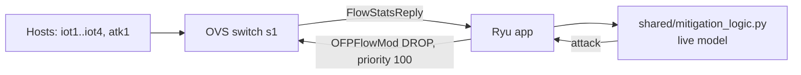

# AI-Driven Anomaly Detection and Mitigation for IoT Traffic in SDN


Most machine-learning intrusion detectors for Software-Defined Networks stop at a classification label: they tell you a flow is malicious, then do nothing about it. This project closes that loop. It classifies network flows **and decides to install an OpenFlow drop rule** for the ones it flags as attacks, using a Ryu controller application and a Mininet testbed.

This repository accompanies the paper *"AI-Driven Anomaly Detection and Mitigation Framework for IoT Traffic in Software-Defined Networks"*.

## Project status

Please read this before relying on any part of the code.

| Component | Status |
|---|---|
| Dataset preparation (`data/data_prep.py`) | Implemented and run on real CICIDS2017 data |
| Model training and evaluation (`models/train_model.py`) | Implemented and run (Random Forest on real data; XGBoost supported but not run on real data) |
| Detect-and-block decision logic (`shared/mitigation_logic.py`) | Implemented; validated by replaying held-out flows and by a pure-Python simulation |
| Ryu controller app (`controller/ryu_mitigation_app.py`) | Implemented, **not executed** |
| Mininet topology and attack script (`mininet_topo/`) | Implemented, **not executed** |
| Open vSwitch demo (`demo/live_ovs_demo.py`) | Implemented, **not executed** |

No Linux virtual machine was available during development, so the Mininet, Ryu and OVS components have **not been run**. Installation of a drop rule on a real switch is therefore unverified. Executing the testbed is the main piece of future work.

## Highlights

- **End-to-end pipeline:** dataset preparation, model training, controller integration, and mitigation logic.
- **Detect, then act:** the controller is designed to poll flow statistics, score each flow with a trained model, and install a high-priority drop rule on attack flows.
- **Two-model design:** a 19-feature model for offline evaluation and a 6-feature "live" model that uses only the counters OpenFlow can provide at runtime.
- **Light inference:** about 0.01 ms per flow, far below the 2-second polling interval.

## Architecture



1. The Ryu app sends an `OFPFlowStatsRequest` to the switch every 2 seconds.
2. For each flow it derives duration, packet count, byte count, byte rate, packet rate, and average packet size.
3. `shared/mitigation_logic.py` scores those features with the trained live model.
4. If the attack probability exceeds 0.70, the controller installs a drop rule for that flow (priority 100, 30 s idle timeout). Other traffic keeps following the normal forwarding rules.

## Repository structure

```
sdn-iot-anomaly-defense/
├── data/
│   └── data_prep.py            # Load, clean, and select features (real CSV or synthetic)
├── models/
│   └── train_model.py          # Train and evaluate Random Forest and XGBoost
├── shared/
│   └── mitigation_logic.py     # Single scoring function used by every demo
├── controller/
│   └── ryu_mitigation_app.py   # Ryu OpenFlow 1.3 app: poll, detect, block (not yet run)
├── mininet_topo/
│   ├── topology.py             # 5-host, 1-switch Mininet topology (not yet run)
│   └── run_attack_demo.sh      # Scripted before/after demo (not yet run)
├── demo/
│   ├── live_ovs_demo.py        # Demo via Open vSwitch, no Ryu needed (not yet run)
│   └── simulate_demo.py        # Pure-Python simulation, no networking needed
├── reports/
│   └── project_report.md       # Project write-up
├── requirements.txt
├── LICENSE
└── README.md
```

`data/processed/` and `models/artifacts/` are generated by the scripts below and are git-ignored.

## Quick start (no SDN tools required)

```bash
git clone https://github.com/alanminu/sdn-iot-anomaly-defense.git
cd sdn-iot-anomaly-defense

python3 -m venv venv
source venv/bin/activate          # Windows: venv\Scripts\activate
pip install -r requirements.txt
```

### Reproducing the paper's results (real CICIDS2017 data)

Download `Friday-WorkingHours-Afternoon-DDos.pcap_ISCX.csv` from the [official UNB site](https://www.unb.ca/cic/datasets/ids-2017.html), then:

```bash
python3 data/data_prep.py --csv /path/to/Friday-WorkingHours-Afternoon-DDos.pcap_ISCX.csv --out data/processed
python3 models/train_model.py
python3 demo/simulate_demo.py
```

`data_prep.py` auto-detects CICFlowMeter, BoT-IoT, and N-BaIoT column names and maps them onto a fixed 19-feature schema.

### Quick dry run (synthetic data, for development only)

```bash
python3 data/data_prep.py --rows 24000 --out data/processed
python3 models/train_model.py
python3 demo/simulate_demo.py
```

The synthetic dataset has cleanly separated classes, so it scores about 100% and does **not** reflect real detection performance. Use it only to check that the pipeline runs.

## Models

Both models are trained by `models/train_model.py` from the same data.

| Model | Features | Purpose |
|---|---|---|
| **Full** | 19 CICFlowMeter-style features (packet lengths, inter-arrival times, TCP flags, and others) | Offline evaluation |
| **Live** | 6 features: flow duration, forward packet count, forward byte count, byte rate, packet rate, average packet size | Inline detection in the controller |

**Why two models?** A live OpenFlow `FlowStatsReply` only exposes duration, packet count, and byte count per flow. Computing the other CICFlowMeter features would require inspecting every packet, which is too slow for inline mitigation. Filling in the missing features with training-set averages was tried and under-detected attacks, because most of the full model's decision weight sits on exactly those guessed features. Training the live model only on observable features avoids this.

## Results

Evaluated on the CICIDS2017 Friday-afternoon DDoS capture: 225,745 raw flows, 214,605 after removing infinite, missing and duplicate records (about 59.7% attack). An 80/20 stratified split gives 171,685 training and 42,920 test flows. Random Forest with 200 trees, class-balanced.

| Model | Features | Accuracy | Precision | Recall | F1 | Inference per flow |
|---|---|---|---|---|---|---|
| Random Forest (full) | 19 | 0.9994 | 0.9999 | 0.9991 | 0.9995 | 0.0074 ms |
| Random Forest (live) | 6 | 0.9992 | 0.9998 | 0.9988 | 0.9993 | 0.0112 ms |

**Detect-and-block replay.** Held-out flows were scored with the live model at the controller's 0.70 confidence threshold. Of 25,602 attack flows, 25,556 were flagged (99.82%). Of 17,318 benign flows, 2 were flagged (0.012%).

### Caveats

- **In-distribution result.** The data is one day's capture from one dataset, with a random stratified split, so flows from the same attack session appear in both training and test sets. This inflates scores compared with deployment on unseen traffic or other attack types.
- **SYN flood is missed.** A synthetic `hping3`-style SYN flood (small packets, about 58 bytes each) was **not flagged** by the model trained on real CICIDS2017 data. The real DDoS flows in that file are short flows with roughly 900-byte packets, so a tiny-packet flood falls outside what the model learned to call an attack. This is a domain mismatch, and it shows that cross-attack generalisation is untested.
- **Replay is not a live poll.** The replay uses CICFlowMeter-computed values for the six features, whereas a live poll supplies partial mid-flow counters.
- **XGBoost** is supported by the training script but was not run on the real data, so the algorithm comparison is incomplete.

## Running the simulation

`demo/simulate_demo.py` runs entirely in Python. It feeds the trained live model a simulated flow at 2-second polling intervals, alongside benign traffic, using the same scoring function the controller uses. It demonstrates the decision logic only, not drop-rule enforcement on a switch. See the SYN flood caveat above for what to expect on a model trained on real data.

## Live SDN testbed (Mininet + Ryu): implemented, not yet validated

The code below has **not been executed**. It requires Linux with root access (a VM works, including the standard Mininet VM), so expect to debug it on first run. Run steps 1 and 2 of the quick start first so a trained model exists.

### Install dependencies

```bash
sudo apt-get install -y mininet openvswitch-switch openvswitch-common \
                        iputils-ping hping3 tcpdump net-tools
pip install ryu
```

Ryu is no longer actively maintained and can break on very new Python or setuptools versions. Python 3.8 to 3.10 is the safest choice. If you hit errors:

<details>
<summary><code>AttributeError: ... easy_install ... get_script_args</code></summary>

```bash
pip install "setuptools==59.6.0" wheel
pip install --no-build-isolation ryu
```
</details>

<details>
<summary><code>ModuleNotFoundError: No module named 'oslo'</code></summary>

Modern `oslo.config` ships as `oslo_config`, but old Ryu still imports `oslo.config`. This shim is intended to fix it:

```bash
python3 -c "
import os, oslo_config
site = os.path.dirname(os.path.dirname(oslo_config.__file__))
os.makedirs(f'{site}/oslo/config', exist_ok=True)
open(f'{site}/oslo/__init__.py', 'w').close()
open(f'{site}/oslo/config/__init__.py', 'w').write('from oslo_config import cfg\n')
"
```
</details>

### Intended demo

**Terminal 1: start the controller**
```bash
ryu-manager controller/ryu_mitigation_app.py --verbose
```

**Terminal 2: start the topology**
```bash
sudo python3 mininet_topo/topology.py
```

**In the `mininet>` prompt:**
```
mininet> iot1 ping -c 4 iot2                       # normal traffic
mininet> atk1 hping3 -S --flood -p 80 iot2 &       # SYN flood
mininet> s1 ovs-ofctl dump-flows s1 -O OpenFlow13  # look for a priority=100 drop rule
mininet> iot1 ping -c 4 iot3                       # unrelated traffic should be unaffected
```

`mininet_topo/run_attack_demo.sh` scripts these steps. Note that, per the results above, a model trained on real CICIDS2017 data is not expected to flag this tiny-packet SYN flood, so the drop rule may not appear unless the model is retrained on matching traffic.

### Alternative without Ryu

`demo/live_ovs_demo.py` is intended to run the same detect-and-block loop by polling Open vSwitch's datapath flow counters, with no controller.

```bash
sudo python3 mininet_topo/topology.py --no-controller   # terminal 1
sudo python3 demo/live_ovs_demo.py s1                    # terminal 2
```

### Topology

```
iot1 --\
iot2 ---\
iot3 ----+--- s1 ---- Remote controller (Ryu, port 6633)
iot4 ---/
atk1 --/
```

`atk1` plays a compromised IoT device, `iot1` to `iot4` generate normal traffic, and `s1` is an Open vSwitch running OpenFlow 1.3.

## Configuration

Key settings in `controller/ryu_mitigation_app.py`:

| Constant | Default | Meaning |
|---|---|---|
| `POLL_INTERVAL` | `2` | Seconds between flow-stats polls |
| `BLOCK_RULE_PRIORITY` | `100` | Priority of the installed drop rules |
| `BLOCK_RULE_IDLE_TIMEOUT` | `30` | Seconds a drop rule persists with no matching traffic |

## Limitations and future work

- Mininet, Ryu and OVS components were never executed; drop-rule enforcement on a switch is unverified.
- Only one day of one dataset and one attack family (DDoS) was used, with a random rather than temporal split.
- SYN-flood and other attack types absent from the training data are not detected.
- Complete the XGBoost comparison on real data.
- Validate across BoT-IoT and N-BaIoT for cross-dataset generalisation.
- Add OpenFlow meter-band rate limiting as a softer response for borderline-confidence flows.
- Compare against a small MLP or 1D-CNN.
- Blocking is per flow match fields, so a spoofed or rotating attacker could evade it.

## Team

| Name | Registration No. |
|---|---|
| Alan Minu | 24BDS0197 |
| Harsh Choudhary | 24BDS0272 |
| Gopalkrishna | 24BCE2901 |
| Samarth Sahu | 24BDS0126 |

School of Computer Science and Engineering, Vellore Institute of Technology, Vellore, India.

## License

This project is released under the [MIT License](LICENSE).
